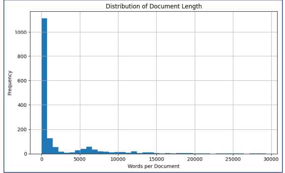
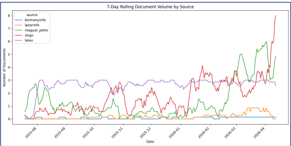
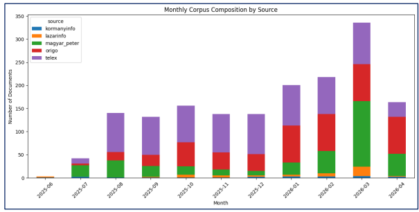
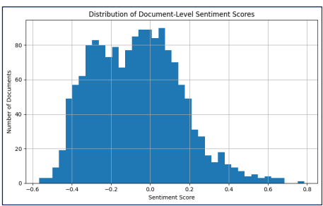
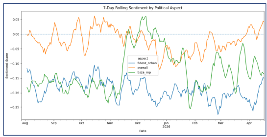

# Sentiment Analysis of the Hungarian Election and Its Effects on Prediction Markets

**Authors:** Fodor Kornél, Nagy Mihály, Szabó Bence, Szugyiczki Flóra
**Date:** 12/05/2026
**Course:** Text Mining and Analysis

---

## Contents

- Introduction
- Data and corpus construction
- Methods
- Results
- Discussion
- Responsible AI/LLM use statement
- Conclusion and next steps
- Appendix
- Tasks and responsibilities

---

## Introduction

The 2026 Hungarian parliamentary election was the first in over a decade where the ruling Fidesz party faced a serious opposition challenger, the Tisza Party, led by Magyar Péter. This project examines whether sentiment in Hungarian news media and speeches made by both candidates/their party correlates with prediction market odds on Polymarket, a decentralised platform where users bet on electoral outcomes in real time.

### Research Hypotheses

**H1: Direct Sentiment Effect**

- **H0:** The sentiment of domestic news coverage has no significant correlation with the Fidesz–Tisza Polymarket spread, at any lead-time.
- **H1:** Domestic news sentiment correlates significantly with the Fidesz–Tisza spread, with allowance for a lead-time offset.

**H2: Media Amplifier Effect**

- **H0:** News coverage sentiment carries no incremental predictive value for Polymarket odds beyond what is already captured by direct political communication.
- **H1:** News coverage sentiment carries significant incremental predictive value, international Polymarket traders respond to media synthesis rather than raw Hungarian press conferences.

**H3: Asymmetric Framing**

- **H0:** There is no significant difference between how pro-government (Origo) and independent (Telex) outlets frame the campaign, and the Polymarket spread does not track one source more closely than the other.
- **H1:** Origo and Telex frame the campaign asymmetrically, and the Polymarket spread tracks the independent Telex series more closely than the pro-government Origo series.

---

## Data and corpus construction

### Corpus construction

The corpus was constructed by combining multiple political communication sources into a unified textual dataset. Raw .csv files originating from Telex articles, Origo articles, and YouTube political speech transcripts (Kormányinfó, Lázárinfó, and Magyar Péter speeches) were first standardized into a common schema before being merged into the final "corpus_master.csv" dataset.

The preprocessing pipeline included metadata normalization, duplicate handling, language consistency checks, lowercasing, URL and punctuation filtering, whitespace normalization, and custom Hungarian stopword removal. Each observation in the final corpus represents a single cleaned document together with its associated metadata, including source, source type, publication date, and cleaned word count.

The analysis ready corpus consists of 2607 observations totalling in about 2.58 million clean Hungarian words, distributed as follows:

| Source | Obs | Words | Windows | Collection method |
|---|---|---|---|---|
| Kormányinfó | 21 | 44k | 2025.06.18. to 2026.04.09. | Transcribed from YouTube using ytdlp and the youtube-transcriptapi library |
| Lázárinfó | 49 | 876k | 2025.06.19. to 2026.04.02. | (same as above) |
| Magyar Péter speeches | 104 | 1.15M | 2025.07.17. to 2026.04.12. | (same as above) |
| Telex articles | 716 | 371k | 2025.07.28. to 2026.04.11. | Platform's internal REST API |
| Origo articles | 491 | 142k | 2025.07.29. to 2026.04.12. | XML sitemap discovery and per-article scraping using trafilatura |
| Polymarket | 986 | - | 2025.07.28. to 2026.04.12. | Bloomberg Terminal |
| **Total** | **2607** | **2.58M** | **2025.06.18. to 2026.04.12.** | |

In addition to the textual corpus, the study also incorporates prediction market data from Polymarket, representing daily market probabilities related to the Hungarian parliamentary election and major political actors. Unlike the news and speech datasets, these records are numerical observations and were used as an external quantitative indicator of public electoral expectations.

The final corpus structure was validated through checks for duplicate document IDs, missing metadata fields, source consistency, and overall corpus statistics before the analytical stage.

### Corpus Descriptive Statistics

The documents by source type vary the following way:

| Source Type | Number of observations |
|---|---|
| Independent news site | 716 |
| Pro government news site | 491 |
| Speeches of the opposing party | 391 |
| Speeches of the governing party | 70 |

*Figure 1*

Document lengths vary considerably across the corpus. The average cleaned document length is 2,366 words, although the distribution is highly skewed, with a median of 381 words and a maximum document length exceeding 29,000 words. This reflects the coexistence of short news articles and long-form political speech transcripts within the dataset.

*Figure 2*

The figure above shows the 7-day rolling document volume by source across the observation period. Telex maintained the most stable publication frequency throughout the corpus window, while Origo and Magyar Péter-related content exhibited substantially higher volatility and stronger growth toward the election period. March and April 2026 show a sharp increase in political communication intensity, especially within opposition-related speech content and pro-government news coverage.

*Figure 3*

Figure 3 illustrates the monthly composition of the corpus by source. The total document volume increased significantly during early 2026, coinciding with the intensification of the election campaign. Telex consistently contributed a large baseline volume across all months, whereas Magyar Péter and Origo content expanded substantially closer to the election date, suggesting increasing political polarization and media activity during the campaign period.

---

## Methods

After preprocessing, the texts were represented using contextual embeddings, and the corpus was analysed using pre-trained multilingual transformer-based sentiment models to generate document-level sentiment scores. The resulting outputs were stored in "sentiment_doc.csv" and later aggregated into daily time-series indicators in "sentiment_daily.csv".

In addition to general sentiment analysis, the project also applied aspect-based sentiment analysis (ABSA) and framing analysis to capture how political actors and topics were discussed across different media sources. These outputs were stored in "absa_doc.csv", "framing_doc.csv", and "framing_daily.csv".

The generated sentiment scores were validated through multiple audit procedures, including checks for duplicate observations, missing values, invalid probability outputs, and sentiment scores outside the theoretical [-1, +1] range. Probability distributions were also verified to ensure consistency across the ensemble model outputs.

Following validation, the daily sentiment indicators were merged with prediction market probability data from Polymarket to construct a unified political time-series dataset. The analysis focused on the relationship between media sentiment dynamics and changes in market-implied electoral expectations.

To improve robustness across different document types, the sentiment framework was designed to handle both short news articles and substantially longer political speech transcripts. Long documents were represented using multiple evenly distributed text segments (up to 5 chunks of about 360 words). This approach relies on the assumption that sampling these evenly spaced windows adequately captures the document's overall sentiment well enough for daily-aggregate downstream use, without overrepresenting individual passages.

The sentiment pipeline combined the outputs of two complementary multilingual transformer models into a single ensemble-based sentiment indicator. Because we relied on zero-shot inference with pre-trained models, no further hyperparameter tuning was conducted. Instead, the ensembling strategy effectively reduced model-specific bias and produced smoother continuous sentiment measures suitable for downstream analysis.

The analysis employs a Vector Error Correction Model (VECM) to isolate both short-run momentum shocks and long-run structural equilibriums. The attached .Rmd workspace documents the complete analytical pipeline, including initial exploratory phases and necessary methodological dead-ends. Initial attempts to model the high-frequency relationship utilized first-differenced daily data and $L_1$ penalized regression (Lasso) for dimensionality reduction. This approach proved structurally inadequate. The mismatch between irregular media publication frequency and continuously changing market prices produced unstable and unreliable results. Recognizing this, the methodology pivoted to utilizing a 7-day rolling average to capture underlying sentiment momentum, allowing for robust cointegration testing. The retained exploratory code serves as documentation of this necessary model selection process.

### Model Specification

Following the identification of $I(1)$ series via the rolling mean transformation, Johansen Trace tests identified $r=2$ cointegrating vectors within the reduced system. A VECM was estimated and subsequently transformed into a Level-VAR to facilitate Forecast Error Variance Decomposition (FEVD) and Orthogonalized Impulse Response Functions (IRF).

---

## Results

The sentiment analysis pipeline generated stable document-level and daily aggregated sentiment indicators across all corpus sources. The distribution of sentiment scores showed mostly neutral and mildly negative values, while extreme positive and negative observations appeared relatively infrequently, as shown in Figure 4.

*Figure 4*

Rolling sentiment trends, shown in Figure 5 revealed clear temporal variation across political aspects and media sources. Sentiment associated with the fidesz_orban aspect remained consistently more negative throughout much of the observation period, while tisza_mp sentiment displayed greater volatility and stronger short-term fluctuations during the campaign period.

*Figure 5*

The merged sentiment and prediction-market dataset suggests that changes in media sentiment and political communication intensity coincided with observable movements in market-implied electoral expectations. Increased media activity and sentiment volatility became particularly visible during the final months of the campaign period.

The analysis confirms that Telex sentiment scores serve as a viable leading indicator for Polymarket odds, with significant short-run coefficients identifying it as the primary predictive source among the variables tested. While the Forecast Error Variance Decomposition indicates a modest contribution to overall variance, the Impulse Response Function demonstrates that the market response is essentially zero in the immediate term, only gradually drifting into a positive trajectory after approximately four days. This suggests that while Telex sentiment informs the market's "ground truth," the information diffusion process is not instantaneous, resulting in a delayed but measurable impact on pricing.

### Key Findings

1. Short-run dynamic equations identify Telex sentiment momentum as the sole statistically significant leading indicator (p < 0.05) among the tested sources.
2. The error correction parameters (alpha) for the Polymarket odds are not statistically significant (alpha is approx 0). This establishes weak exogeneity, indicating that while media sentiment provides a predictive signal, the prediction market does not mechanically mean-revert to a media-defined "fair value" in the long run.
3. FEVD analysis demonstrates that exogenous shocks to Telex sentiment explain approximately 3.16% of the forecast error variance in Orbán's odds at a 14-day horizon.
4. The IRF indicates that the market response to a sentiment shock is negligible in the immediate term (t < 4 days) but exhibits a persistent, positive drift thereafter. This confirms that Telex informs the market's pricing, but the diffusion of this information is subject to a multi-day delay.

---

## Discussion

- Political communication intensity increased significantly closer to the 2026 parliamentary election period.
- Independent and pro-government media sources displayed different sentiment dynamics, while opposition-related speech content showed higher volatility.
- From a societal perspective, the findings highlight the growing importance of online political communication and media narratives in shaping electoral expectations and public discourse.
- Several limitations and threats to validity should be acknowledged, including potential sentiment-model bias, difficulties in interpreting sarcasm and context-dependent political language, unequal source representation, and the limited time horizon of the collected data.

---

## Conclusion and next steps

While the prediction market is primarily autoregressive, specific independent media channels—most notably Telex—provide a measurable, delayed predictive signal regarding political probabilities. The complete documentation of the data engineering, failed linear iterations, and final structural VECM is retained in the source file for peer review.

The exploratory findings provide support for all three research hypotheses. First, the observed co-movements between aggregated sentiment indicators and Polymarket probabilities suggest that domestic media sentiment may contain information relevant to changes in electoral expectations (H1). Second, the stronger visibility of news-media dynamics relative to raw political speech activity indicates that media interpretation and amplification may play an important role in shaping international prediction-market reactions (H2). Finally, clear differences between Telex and Origo sentiment dynamics support the existence of asymmetric political framing across the Hungarian media environment (H3).

Future development should focus on expanding the temporal coverage of the dataset, refining aspect-level analysis, and implementing more advanced forecasting and deployment solutions.

---

## Responsible AI/LLM use statement

Large Language Models, including ChatGPT, Claude and Google Gemini were used as supportive research and writing assistants during selected stages of the project. Their use was limited to high-level methodological brainstorming, code debugging support, exploratory workflow planning, formatting assistance, and improving the clarity and structure of written sections.

All scraping pipelines, preprocessing procedures, sentiment calculations, statistical analyses, and time-series modelling steps were verified manually by the team.

Some typical prompts were:

- suggesting validation and auditing methods
- improving academic wording
- generating boilerplate code structures

---

## Appendix

### Key Parameter Settings

| Component | Setting |
|---|---|
| Text Processing | Lowercasing, punctuation removal, Hungarian stop word filtering |
| Sentiment range | [-1, +1] |
| Rolling window | 7 days |
| Aggregation level | daily |
| Validation checks | Duplicate, missing value, and range audits |

### Additional Figures

---

## References

- Tsang, K. P., & Yang, Z. (2026). The anatomy of Polymarket: Evidence from the 2024 presidential election. arXiv. https://doi.org/10.48550/arXiv.2603.03136
- Cutting, L. E., Hughes-Berheim, S. S., Johnson, P. M., Baroud, H., & Goldstein, B. (2025). Are betting markets better than polling in predicting political elections? arXiv. https://doi.org/10.48550/arXiv.2507.08921
- Clinton, J. D., & Huang, T. (2025). Prediction markets? The accuracy and efficiency of $2.4 billion in the 2024 presidential election.
